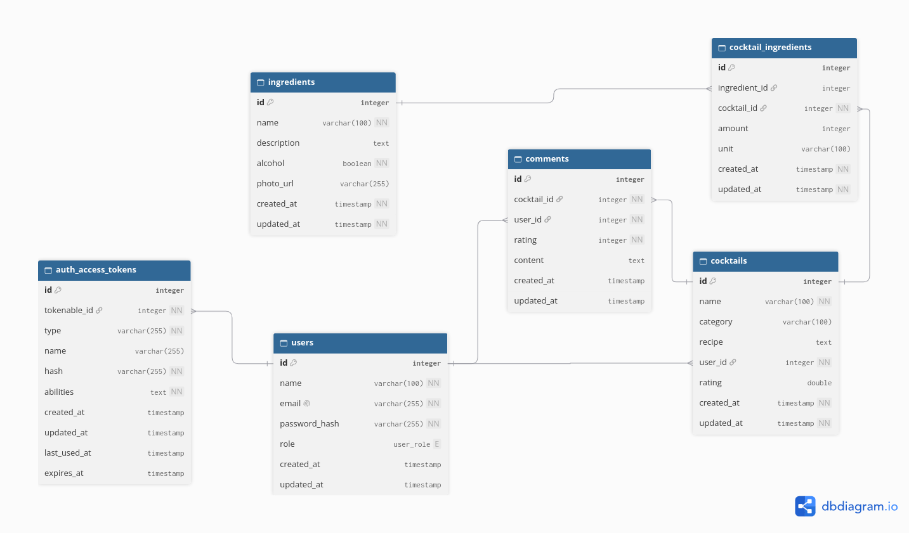

# KoktajlBar API

REST API do zarządzania przepisami na koktajle, składnikami i ocenami,
przygotowane w TypeScript z wykorzystaniem AdonisJS 7 i MariaDB.

## Funkcjonalności

- Zarządzanie koktajlami i katalogiem składników.
- Przypisywanie składników do przepisu wraz z ilością i jednostką.
- Filtrowanie koktajli według autora, kategorii, składników i zawartości alkoholu.
- Paginacja i sortowanie list.
- Rejestracja i logowanie z tokenami Bearer oraz rolami `user` i `admin`.
- Kontrola uprawnień na podstawie roli i właściciela wpisu.
- Komentarze i oceny z automatycznym przeliczaniem średniej.
- Interaktywna dokumentacja Swagger UI i dane demonstracyjne.

## Technologie

TypeScript · AdonisJS 7 · Lucid ORM · MariaDB · VineJS · OpenAPI / Swagger UI ·
Japa · ESLint · Prettier

## Wymagania

- Node.js 24 lub nowszy
- npm 11 lub nowszy
- MariaDB — projekt rozwijany na wersji 11.8.6

## Uruchomienie lokalne

### 1. Pobierz projekt i zainstaluj zależności

```bash
git clone https://github.com/glakszymon/KoktajlBarApi.git
cd KoktajlBarApi
npm ci
cp .env.example .env
```

### 2. Skonfiguruj bazę danych

Utwórz pustą bazę MariaDB i użytkownika z uprawnieniami do migracji oraz operacji
na danych. Ustaw parametry połączenia w `.env`:

```dotenv
DB_HOST=127.0.0.1
DB_PORT=3306
DB_USER=koktajl
DB_PASSWORD=local_example_password
DB_DATABASE=koktajl_bar
```

### 3. Przygotuj dane i uruchom aplikację

```bash
node ace generate:key
node ace migration:run
node ace db:seed
npm run dev
```

| Adres                         | Opis                        |
| ----------------------------- | --------------------------- |
| http://localhost:3333         | API                         |
| http://localhost:3333/docs    | Swagger UI                  |
| http://localhost:3333/swagger | Specyfikacja OpenAPI w YAML |

## Dane demonstracyjne

Seeder przygotowuje **20 składników, 18 koktajli, 10 komentarzy i ocen** oraz dwa
konta. Przepisy obejmują różne kategorie, autorów i koktajle bezalkoholowe.

| Rola          | Email               | Hasło demonstracyjne   |
| ------------- | ------------------- | ---------------------- |
| Administrator | `admin@example.com` | `Demo-password-12345!` |
| Użytkownik    | `user@example.com`  | `Demo-password-12345!` |

Powyższe hasła są przeznaczone wyłącznie do lokalnego demo.
Seeder jest dostępny w środowiskach `development` i `test`.

### Sprawdzenie API w Swagger UI

1. Otwórz http://localhost:3333/docs.
2. Wykonaj `POST /auth/login`, używając jednego z kont demonstracyjnych.
3. Skopiuj `token.value` z odpowiedzi.
4. Kliknij **Authorize** i w polu **BearerAuth** wklej sam token, bez prefiksu `Bearer`.
5. Sprawdź `GET /auth/me` oraz operacje tworzenia, edycji i usuwania wpisów.

Listy i szczegóły koktajli, składników oraz komentarzy są dostępne bez logowania.

Przykładowe zapytania:

```http
GET /cocktails?page=2
GET /cocktails?alcohol=false
GET /cocktails?category=Sour&sortBy=name&sortOrder=asc
GET /ingredients?page=2
```

### Logowanie przez curl

```bash
curl -X POST http://localhost:3333/auth/login \
  -H 'Content-Type: application/json' \
  -H 'Accept: application/json' \
  -d '{"email":"user@example.com","password":"Demo-password-12345!"}'
```

Do chronionych endpointów przekaż otrzymaną wartość `token.value`:

```bash
TOKEN='TOKEN_Z_ODPOWIEDZI_LOGOWANIA'
curl http://localhost:3333/auth/me \
  -H 'Accept: application/json' \
  -H "Authorization: Bearer $TOKEN"
```

## Uprawnienia

| Operacja                                                | Dostęp                             |
| ------------------------------------------------------- | ---------------------------------- |
| Przeglądanie koktajli, składników i komentarzy          | Publiczny                          |
| Tworzenie koktajli oraz dodawanie komentarzy i ocen     | Zalogowany użytkownik              |
| Edycja i usuwanie koktajlu                              | Właściciel lub administrator       |
| Usuwanie komentarza                                     | Autor komentarza lub administrator |
| Zarządzanie katalogiem składników i rolami użytkowników | Administrator                      |

Rejestracja tworzy konto z rolą `user` i wymaga hasła o długości 15–128 znaków
oraz zgodnego `password_confirmation`. Token dostępu jest ważny 24 godziny;
`POST /auth/logout` unieważnia bieżący token.

## Filtrowanie koktajli

`GET /cocktails` zwraca listę w formacie `{ "data": [...], "meta": {...} }`.

| Parametr        | Znaczenie                                                                                |
| --------------- | ---------------------------------------------------------------------------------------- |
| `userId`        | ID autora przepisu                                                                       |
| `category`      | Kategoria, np. `Long Drink`, `Sour` lub `Mocktail`                                       |
| `alcohol`       | `true` — koktajle alkoholowe, `false` — bezalkoholowe                                    |
| `ingredientIds` | ID składników oddzielone przecinkami; przepis musi zawierać wszystkie wskazane składniki |
| `page`          | Numer strony, domyślnie `1`                                                              |
| `limit`         | Liczba wyników od `1` do `100`, domyślnie `10`                                           |
| `sortBy`        | `id`, `name`, `category`, `created` lub `updated`; domyślnie `id`                        |
| `sortOrder`     | `asc` lub `desc`, domyślnie `asc`                                                        |

Filtry można łączyć. ID autorów i składników są dostępne w odpowiedziach API.
Pełne kontrakty endpointów, parametry i przykładowe odpowiedzi znajdują się w Swagger UI.

## Testy i jakość kodu

Testy integracyjne obejmują uwierzytelnianie, uprawnienia, operacje na koktajlach
i składnikach, filtrowanie, paginację, komentarze, średnie ocen oraz seeder.

Przygotuj **osobną, pustą bazę testową** i ustaw jej parametry w `.env.test`.
Testy wykonują migracje oraz tworzą i usuwają dane.

```bash
npm test
npm run lint
npm run typecheck
npm run build
```

## Diagram bazy danych



## Struktura projektu

```text
app/
  controllers/   Obsługa żądań HTTP
  middleware/    Uwierzytelnianie i kontrola ról
  models/        Modele i relacje Lucid
  services/      Logika operacji na danych
  validators/    Walidacja danych wejściowych
config/          Konfiguracja aplikacji i OpenAPI
database/
  migrations/    Tworzenie struktury bazy
  seeders/       Dane demonstracyjne
start/routes.ts  Definicje tras
tests/           Testy integracyjne i dane pomocnicze
```

Relacja koktajli ze składnikami przechowuje ilości i jednostki w tabeli pośredniej.
Autor wpisu jest ustalany na podstawie tokena. Dodawanie i usuwanie komentarzy
oraz aktualizacja średniej ocen odbywają się w transakcji.
